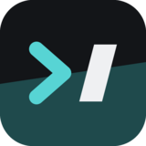
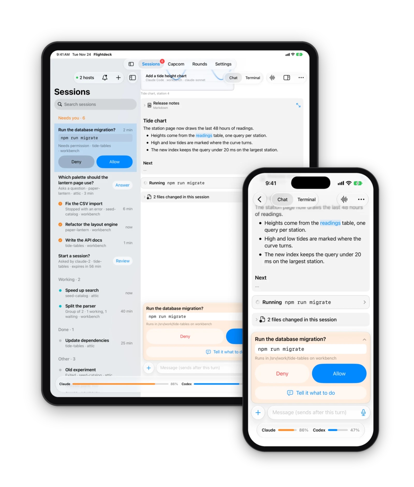
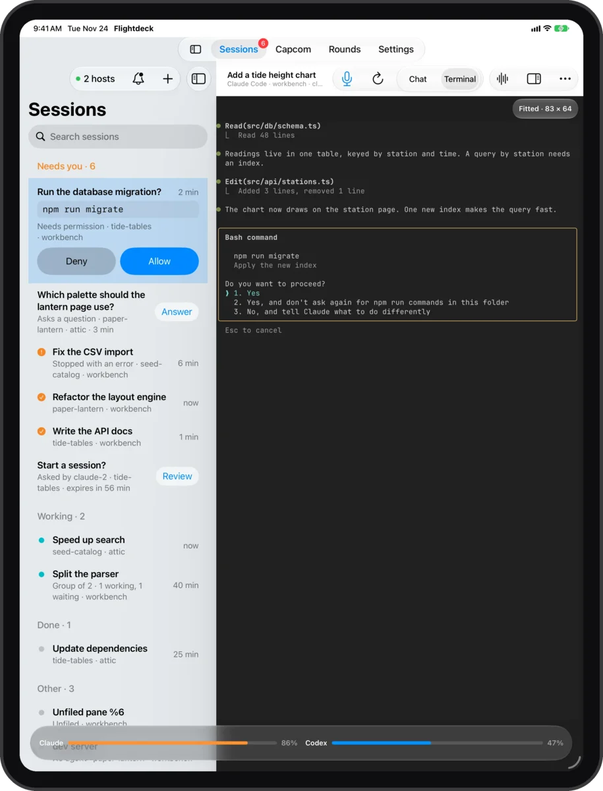
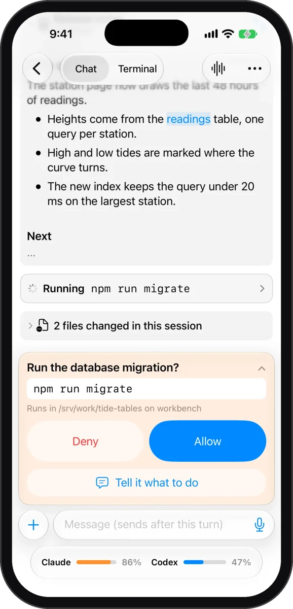

<p align="center">
  
</p>

<h1 align="center">Flightdeck</h1>

<p align="center">Your coding agents, on every machine, in one app.</p>

<p align="center">
  <a href="https://github.com/noahkiss/flightdeck/releases?q=app-v&expanded=true"><b>Download for Mac</b></a> ·
  <a href="#iphone-and-ipad">iPhone and iPad</a> ·
  <a href="#the-hab-on-each-computer">Install the hab</a> ·
  <a href="#documentation">Docs</a> ·
  <a href="https://github.com/noahkiss/flightdeck/releases">Releases</a>
</p>

<p align="center">
  
</p>

You run coding agents on more than one computer, in more than one terminal. One of them stops
to ask a question, and you find out an hour later. Flightdeck puts every agent on every machine
on one board. It tells you which one needs you, and lets you answer from your phone.

Flightdeck works with Claude Code, Codex and opencode. Your agents keep running when you close
the app. Each one keeps its own transcripts, so you can still resume any session from a plain
terminal.

## What you get

- **Every agent in one place.** The status board shows each session on each computer, sorted by
  what needs you first.
- **Know who needs you.** A notification tells you when an agent waits for approval, asks a
  question or hits an error.
- **Approve from anywhere.** Allow or deny a tool call from your iPhone, iPad or Mac, even from
  the lock screen.
- **A real chat view.** Read the conversation with formatted text, code and tool cards, and type
  your reply. Switch to the terminal view when you want the raw screen.
- **Sessions that survive.** Closing the app or updating the server never stops a running agent.
- **Your tools stay yours.** Flightdeck reads each agent's own files and runs it in its own
  terminal. Nothing gets locked in.
- **Capcom.** Ask a question or start work without picking a project folder first. Capcom
  answers, or hands the work to the right session.

<p align="center">
  
  
</p>

## Install

Flightdeck has two parts. The app runs on your Mac, iPhone and iPad. The hab is a small
server that runs on each computer where your agents work.

### Mac app

Download `Flightdeck-<version>-macos-arm64.zip` from the latest
[app release](https://github.com/noahkiss/flightdeck/releases?q=app-v&expanded=true), unzip it
and move Flightdeck to Applications. The app is signed with Developer ID and notarized by Apple.

### iPhone and iPad

There is no public App Store or TestFlight build. Build the app from source and install it on
your own devices with your own Apple developer team. [CONTRIBUTING.md](CONTRIBUTING.md#the-app-swift)
shows how.

### The hab on each computer

Install the hab and the `gff` terminal client with Homebrew, on macOS or Linux:

```sh
brew install noahkiss/tap/gff
gff-hab install
```

Run `gff-hab install` again after each `brew upgrade gff`.

### Pair the app

On the computer, run:

```sh
gff-hab pair
```

It shows a QR code for 10 minutes. On your iPhone or iPad, scan it. On a Mac, run
`gff-hab pair -link` instead, choose "Type the code" and paste the link.
To look around first, choose "Look around with demo data".

### You also need

- A coding agent installed and signed in on the computer: Claude Code, Codex or opencode.
- SSH on each computer you reach from another device (on a Mac, turn on Remote Login). The app
  connects through it, and pairing adds the device's key for you. The Mac app needs no SSH for
  the hab on its own Mac.
- A network path from your devices to each computer: the same local network, or a private
  network such as a VPN.
- macOS 26 for the Mac app; iOS 26.1 or iPadOS 26.1 for the iPhone and iPad app.
- Apple silicon for the Mac app and for the hab on macOS. The hab on Linux runs on x86-64 and
  arm64.

## Documentation

- [The app](docs/specs/app.md): the status board, chat, terminal, approvals and notifications
- [The `gff` terminal client](docs/specs/gff-client.md)
- [Capcom](docs/specs/capcom.md)
- [Pairing and connections](docs/specs/transport.md)
- [Supported agents](docs/specs/harness-adapters.md)

All specs are in [docs/specs/](docs/specs/).

## Contributing

Issues and pull requests are welcome. [CONTRIBUTING.md](CONTRIBUTING.md) explains how to build
from source, run the tests and cut a release. [docs/layout.md](docs/layout.md) gives the
architecture and the repo layout.

## License

MIT. See [LICENSE](LICENSE). Third-party notices are in [NOTICE](NOTICE) and
[apple/App/Acknowledgements.txt](apple/App/Acknowledgements.txt).
